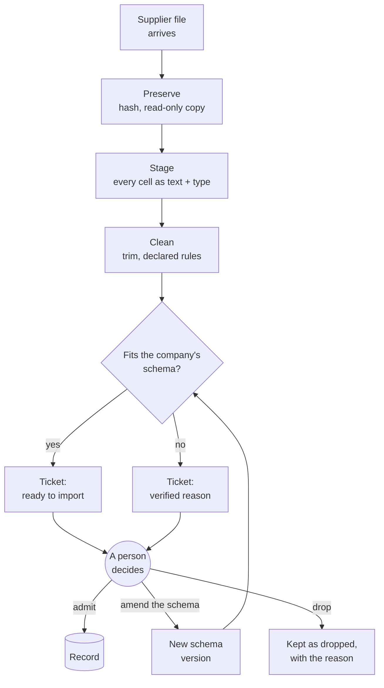
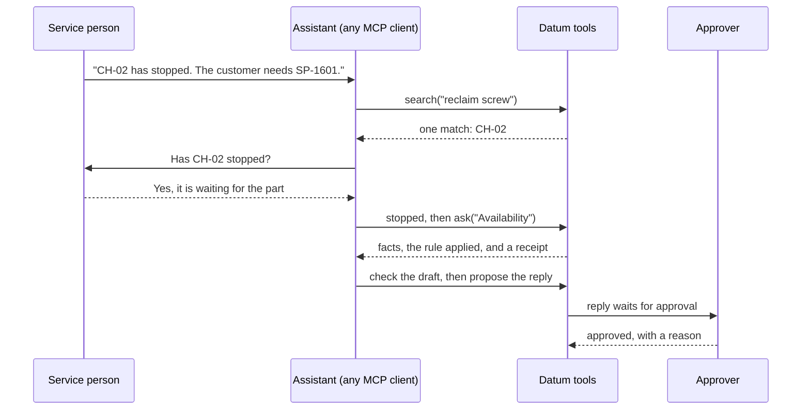
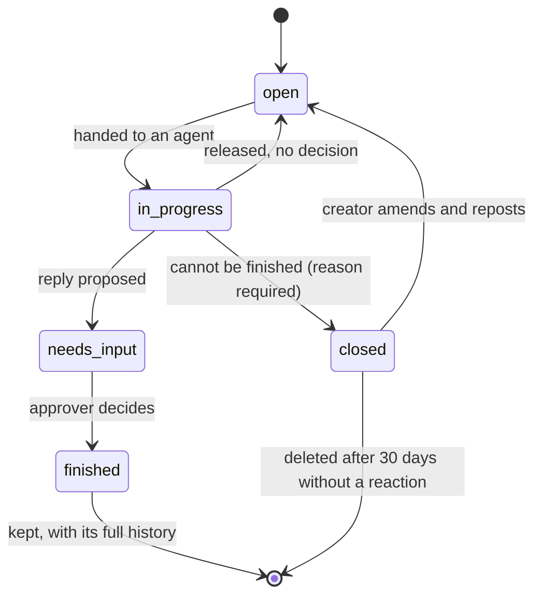

# Datum

*A governed record for company data, from intake to decision.*

**Data is the map of the environment.** Datum keeps one record of what a company's data says, and lets each
role draw its own view of it, with the evidence and the unknowns stated.

Operational data arrives as spreadsheets with their own columns, units and habits. Datum does four things with it:

1. **Preserves** each arriving file, unchanged, with a content hash and a ledger line.
2. **Checks** it against the header declaration the company's schema requires. A file that does not fit is refused
   with a verified reason; nothing is guessed into shape.
3. **Routes** the result to a person. A ticket records what was found. A named person admits data to the record.
4. **Answers** questions from the record through role tools, served to an MCP client over stdio, with a receipt:
   the tools run, the rule applied, the checks passed, and what is not known.

Code measures and applies rules. An assistant asks, explains and drafts, and cannot change data or send anything.
People decide what enters the record and what is approved.

## How it works

### 1. A file arrives

Every file takes the same path, whether a person dropped it in the folder or a collector fetched it.
Nothing reaches the record until a person decides.



### 2. A customer calls

The assistant runs Datum's tools through MCP. It asks the person what only the person knows, and
explains what the tools found. It cannot send a reply: an approver does.



### 3. Every piece of work is a ticket



### What an answer looks like

Every answer ends with a receipt: what was asked of the person, which tools ran, which rule decided,
what was checked, and what the system does not know.

```text
RECEIPT  #1 question 2: Availability of SP-1601 for CH-02
  asked of the person   machine stopped: yes (breakdown)
  tools run             machine_context · stock_by_warehouse · fastest_supply · incoming_orders ·
                        lead_time · substitutes · conflicts · where_used · due_soon · recommended_plan
  rule applied          breakdown → fastest option
  not known             competing claims on PO-4718 are not modelled: SC-01 is overdue for 3 pcs,
                        also served from FI
  needs approval        the reply waits for a named approver. Nothing is sent
```

All of this runs on a synthetic spare-parts company. Run `python scripts/demo_run.py --out output/demo`
to replay the whole scenario.

## What works today

- **Schema registry:** typed fields, keys and references; every row is accepted or refused with a code.
- **Intake:** inbox preservation, staging of Excel cells with their types and row provenance, a cleaning stage
  (trimming and declared case rules, every change recorded), the trial against a company's schema, schema
  versions and a strict create-schema gate.
- **Tickets:** one store for work, with claims, a journal, approvals, and the statuses `open`, `in_progress`,
  `needs_input`, `closed` and `finished`. A closed ticket is deleted after 30 days without a person's reaction;
  a finished ticket keeps its history.
- **Customer-service slice:** search, consultations as tickets, availability and lead-time answers with a receipt,
  answer checks, and proposals for an approver. Golden tests cover the reference scenario.
- **MCP server:** `python -m datum.mcp.server` serves a role's tools (the customer-service role first) to any MCP
  client over stdio. Each tool is a plain Python function in the role's registry; the server only passes calls
  and text through.
- **Demo run:** `scripts/demo_run.py` runs one synthetic scenario end to end and writes it as plain files, for the
  static demo page to read.
- **Desk views:** the text screens of a spare-parts desk, ported with golden tests.
- **Synthetic data:** a spare-parts company with a year of history, and a generator for a weekly stock export with
  a renamed-column variant.

## Data

Synthetic data only. The repository contains no real company, supplier or customer data, and none is used by the
tests. Real data is out of scope until it is approved for use.

## Running the tests

```text
pip install -e ".[test]"
python -m pytest
```

Python 3.11 or newer. The tests build their fixtures from the synthetic company and do not call any model.

## The daily sweep

Closed tickets are deleted after their retention period. The sweep runs only when it is called:

```text
python -m datum.record.sweep --store PATH_TO_STORE.sqlite --today YYYY-MM-DD
```

It exits with a non-zero code and prints the error when it fails. Scheduling it is left to the operator.

## Connecting an MCP client

The server speaks MCP over stdio: the client starts it as a command and talks to it through its standard input and
output. In the client's configuration (for example `claude_desktop_config.json`):

```json
{ "mcpServers": { "datum": { "command": "python", "args": ["-m", "datum.mcp.server", "--store", "<path>"] } } }
```

- `command` is the Python that has Datum installed (`pip install -e .`); give its full path if it is a virtual
  environment's.
- `<path>` is the ticket store, a SQLite file. A new one is created if there is none; the demo run below writes
  one (`output/demo/record.sqlite`), with its tickets.
- The client gets the customer-service tools (`search`, `open_consultation`, `stopped`, `ask`, `check`,
  `propose_reply`, `release`, `resume`, `close`) and the role's instructions. `search` is marked read-only; the
  others write to the record (a ticket, a journal entry, a check, a proposal) and are marked so.
- The tools act as one user of the record: `mcp-consultant`, an agent with the worker role, added to the store the
  first time. `--actor NAME` acts as an existing user instead. `--role` names the role; `customer-service` is the
  only one so far.

The server calls no model and sends nothing outside the process: it reads requests from its standard input and
writes replies to its standard output. The assistant on the other side explains and drafts; it cannot approve a
reply or send anything, because no tool does. A named approver decides in the approval queue.

## Running the demo

```text
python scripts/demo_run.py --out output/demo
```

One synthetic scenario, end to end, with fixed dates, no model and no scheduler, on a fresh record:

1. The company's stock-export schema, version 1: the first weekly export arrives before there is a schema; a
   worker drafts version 1 from it, and an approver confirms it at the create-schema gate and admits the file.
2. The weekly stock export arrives, passes the trial against version 1, and an approver admits it.
3. The next export arrives with a renamed column. It is refused with a verified reason; a worker drafts the
   amendment, version 2, an approver confirms it, and the file loads under version 2.
4. A customer call: CH-02 has stopped and needs SP-1601. The consultant's tools ask the person whether the machine
   has stopped, answer with a receipt, check the reply and propose it; an approver's approval finishes the call.
   The reply is a fixed text: no model runs.
5. A call that cannot be finished is closed by the worker, with the reason and the notice to the person who answers
   for it. The sweep, run once 31 days later, deletes it and keeps the finished tickets.

The directory then holds plain files: `demo.json` and `demo.md` (each step, its ticket, the ticket's status changes,
every call and what came back, and the receipt; then the record after the run), `record.sqlite` (the ticket
store), `data/` (the company's folder: inbox, staging and cleaning records) and `arrivals/` (the files as they
arrived). Two runs with the same arguments write byte-identical `demo.json` and `demo.md`. The directory must be
new, empty or an earlier output of the script, which is replaced; `output/` is ignored by git.

## Documentation

- [docs/plan.md](docs/plan.md): purpose, principles, status and phases.
- [docs/backlog.md](docs/backlog.md): every item, its status and its source.
- [docs/build-plan.md](docs/build-plan.md): the decisions taken, in order.
- [docs/intake.md](docs/intake.md): how a file becomes data.
- [docs/slice-customer-service.md](docs/slice-customer-service.md): the customer-service slice.
- [docs/provenance.md](docs/provenance.md): where each ported piece comes from.
- [docs/work-order.md](docs/work-order.md): what is still to finish.

## Status

Pre-release. The core, the intake chain, the MCP server and the demo run are built and tested. Not yet built: the
demo interface (the static page that will read the demo run's files) and recorded replays, the analyst tools, the
worklist, and the scheduling of the manager run. There is no hosted demo yet.

## Code layout

- `datum/`: the domain-free core (schema, intake, record, checks, the tool registry and the MCP server).
- `domains/spare_parts/`: the first domain pack (schema, synthetic company, rules, views, customer-service tools).
- `tests/`: the test suite, golden files and synthetic fixtures.
- `scripts/`: the demo run (`demo_run.py`) and golden-file regeneration. The `capture_lab_*` scripts are for the
  maintainer only: they read the private research repositories the reference text was captured from, and cannot
  run without them.

## Lineage

The rules and some code come from earlier research projects, kept in their own repositories. Each ported piece
records its origin in [docs/provenance.md](docs/provenance.md). The projects are not merged, and their evidence is
not edited.

## Licence

No licence has been chosen yet. Until one is added, all rights are reserved.
