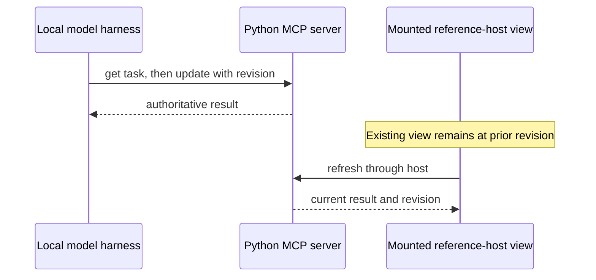

# Experiment 4 — conversation and interface synchronization

Research and tests: 28 October 2026. The question is whether a conversation and an embedded MCP App can coordinate around one persistent synthetic task. **A true conversational host was not tested.** The reference host is a manual test client; the local Qwen tool harness is a model client but does not render the App or receive the reference host's context. The two were used alongside each other to test a model-originated MCP update and a later UI refresh, not to simulate a completed chat integration.

## Architecture and state

The existing Python rules and SQLite task store remain authoritative. `conversation_experiment.py` exposes a compact view and app-only refresh/evaluate tools; `datum_conversation_update` is model-visible. Both update paths call the same `task_domain.evaluate_task` and `TaskStore.evaluate` functions. `conversation_view.html` is a small inline card: task/status, scenario and substitute-evidence controls, Evaluate, Refresh, collapsible evidence, Share context and Ask agent. It does not run model-supplied JavaScript. A supplier task uses the same resource but disables repair-only controls.

Business revision is the count of stored evaluations plus reviews. Reads, selection and communication/audit events do not advance it. The compact view submits its observed revision with an evaluation; the store checks it inside the same SQLite write transaction before appending the result. A stale request fails rather than overwriting newer state. The existing Experiment 3 renderer now also submits a revision. Legacy API clients may omit the optional revision on `datum_task_ui_evaluate` or use the older unguarded agent tool; this prototype therefore does **not** guarantee conflict protection across every possible client. New `datum_conversation_evaluate` and `datum_conversation_update` require it.

Selection, expanded evidence and unsaved controls live in each iframe, not the business task. Explicit Refresh replaces a draft. A `visibilitychange` event refreshes a clean view; when a draft exists it warns and preserves it. The test dispatched that event synthetically; actual host activation/suspension policies are not established. A host-pushed tool result is accepted in the controlled bridge test when clean and deferred when the view has a draft. No claim is made that the reference host or another host will push such updates.

## Protocol and host compatibility

Sources: the stable [MCP Apps specification 2026-01-26](https://github.com/modelcontextprotocol/ext-apps/blob/main/specification/2026-01-26/apps.mdx), its [reference host](https://github.com/modelcontextprotocol/ext-apps/tree/main/examples/basic-host), and [MCP core 2026-07-28](https://modelcontextprotocol.io/specification/2026-07-28). The tested host/SDK negotiated core **2025-11-25** and Apps **2026-01-26**; this is not a test of the new core revision.

| Mechanism | Protocol / optional host behavior | Observed in pinned basic-host | Real conversational host |
| --- | --- | --- | --- |
| `ui/initialize`, capabilities | Host returns capabilities and context; view checks them. | Advertised server tools and text context updates, inline/fullscreen; did **not** advertise message capability. | Not tested. |
| `tools/call` | A view may request a permitted same-server tool; host mediates and may deny it. App-only visibility is routing, not authentication. | App-only evaluation and refresh worked; model-visible update was called by a separate scripted client and a local Qwen harness. | Not tested as an embedded chat interaction. |
| `ui/notifications/tool-result` | Host delivers opening tool results to the view; later host behavior is not equivalent to server push into a mounted iframe. | Opening result rendered. A separate task update left the mounted view stale until refresh. | Not tested. |
| `ui/update-model-context` | View sends context; host may reject and SHOULD provide it on a future turn. Updates replace earlier context; acknowledgement does not itself trigger a model turn or prove model delivery. | Host acknowledged and displayed each view's own task ID, revision, evaluation, receipt and selected record. It has no conversation model to consume them. | Not tested. |
| `ui/message` | A view can request a user-role follow-up; a host can reject or seek consent. Acceptance is not proof of a response. | Source has an `onmessage` handler, but the host did not advertise `message`; the button stayed disabled and no unadvertised request was sent. | Not tested. |
| `ui/notifications/host-context-changed` and display modes | Host may notify context changes; view checks available modes and handles actual result. | Inline and host fullscreen requests and mode updates worked. This is not the browser Fullscreen API. | Not tested. |
| `ui/resource-teardown` | Host requests cleanup; view responds; task persistence is separate. | Host logged a teardown request; closing and reopening the view retained task state. | Not tested. |

There is a documentation ambiguity in the dated Apps prose example for `ui/message`: it shows a single content object, while the pinned reference SDK's generated `McpUiMessageRequest` type uses `ContentBlock[]`. The controlled bridge uses the SDK's array shape. Since the reference host did not advertise the capability, neither shape was sent to it. Other host versions may differ.

[OpenAI's official UI documentation](https://developers.openai.com/plugins/build/chatgpt-ui) describes ChatGPT's MCP Apps bridge and model-context updates; that is documentation, not a test of this local server in ChatGPT or Codex. [Goose's own documentation](https://github.com/aaif-goose/goose/blob/main/documentation/docs/guides/interactive-chat/mcp-ui.md) labels its Apps features experimental and distinguishes standalone windows from chat. Neither was connected here. LM Studio and Jan were installed locally, but we did not establish that their installed versions support the required embedded Apps bridge; LM Studio's [MCP documentation](https://lmstudio.ai/docs/developer/core/mcp) describes tool calls, which alone do not prove Apps rendering, and Jan has an [open Apps request](https://github.com/janhq/jan/issues/7556). Claude, ChatGPT, Codex, Goose, LM Studio and Jan are therefore **untested for this experiment**, not declared compatible or incompatible.

## Communication sequences

```mermaid
sequenceDiagram
    participant H as Host
    participant V as App view
    participant S as Python MCP server
    participant D as SQLite
    H->>S: datum_conversation_open(task ID)
    S->>D: read task and revision
    S-->>H: UI resource + structured result
    H->>V: initialize, tool-input, tool-result
    V->>H: tools/call evaluate(task, expected revision)
    H->>S: app-only tool call
    S->>D: check revision and append evaluation atomically
    S-->>H: updated result
    H-->>V: tool response
    V->>H: ui/update-model-context(task, revision, evidence IDs)
    H-->>V: acknowledgement; no model turn implied
```



The second sequence was actually tested with Qwen, but the harness manually supplied the task ID and user request. The first sequence's context acknowledgement was observed in the reference host; the host did not deliver it to Qwen. `ui/message` acknowledgements and denials were exercised only in a controlled mock host. No direct server-to-mounted-view push was established.

## Test results

### Level A — controlled bridge and Python

`tests/test_conversation_bridge.cjs` uses a mocked parent, not an MCP server or model. It checked initialization, task-specific context payloads, message payloads, acknowledgements, a denied context request, disabled unsupported capabilities, app-only request shape, stale rejection, explicit refresh, display-mode response, teardown response, and a simulated host-pushed result with draft protection. `tests/test_conversation_task.py` checks revision handling, stale writes, task isolation and protection of the prior renderer. All **42 Python tests passed**, including the existing scripted MCP test against the disposable server. The existing Experiment 3 reference-host regression also passed after the revision change.

### Level B — official reference host

On Windows 11 with Chrome and basic-host revision `07cda2513b0b691ac261ac69c856062c9afb2824`, Playwright opened two simultaneous BC-01 views and a supplier view. Selecting a record did not change the business revision. Both task IDs were separately checked in the host's context panels. A GUI evaluation worked through the app-only tool without a model. One view did not automatically update the other; explicit refresh did. A scripted model-facing update left the mounted view unchanged, and a stale submission was rejected. A synthetic visibility event refreshed a clean view and preserved a draft. The host granted fullscreen/inline, requested teardown, and reopening recovered the task. The checks did not establish what happens when a real conversation continues for several messages or an older message is revisited.

The host displayed context updates but did not advertise conversational messages, so Ask agent was unavailable. No `ui/message` request or model follow-up was tested in this host. No JavaScript page errors appeared; Chrome logged one unattributed 404. [Reference-host screenshot](screenshots/conversation-reference-host.png), [supplier view](screenshots/conversation-supplier-host.png), [final host event record](evidence/conversation-reference-host-final.json). A separate earlier host/model run is in [host/model event record](evidence/conversation-reference-host.json).

### Local model — tool harness, not Level C chat-host success

Local Qwen 3.5 9B was given the task ID and the prompt to show hypothetical delivery and preserve the substitute setting. It independently selected `datum_task_get`, then `datum_conversation_update` with the current revision. Both calls succeeded. While the separate reference-host view was mounted, the task changed in SQLite but the view remained on revision 3 until Refresh showed revision 4. The host context update was **not** delivered to the model; the harness supplied the task ID explicitly. [Raw transcript](evidence/conversation-qwen.json).

Semantic comparison with Python: Qwen labelled the delivery hypothetical, retained the substitute flag and stated that the result was not an ERP action. However, it wrote that the machine “would be repairable” if deliveries occurred; the deterministic output establishes synthetic parts readiness only and explicitly leaves condition and labour unknown. This is an unsupported conclusion. It did not discuss the unmodelled alternative mapping; the run contained no human review, so treatment of an unverified review was not tested. Do not treat the model's answer as operational approval. The full response is preserved, not corrected.

### Level C — real conversational host

**Not established.** No locally available conversational host was confirmed to both render this resource and deliver `ui/update-model-context`/`ui/message` to an actual model. We did not connect a cloud chat, tunnel the local server, or modify a host's configuration. There is no screenshot of an actual chat experience. Context surviving several conversational messages, model receipt of app context, `ui/message` initiating a real follow-up, chat-to-mounted-view updates, suspension/recreation and cross-view context policies remain untested.

## Reproduction and instrumentation

See [README.md](README.md) for the Python SDK and pinned basic-host installation. Use a new disposable database; do not reuse the Experiment 3 database:

```powershell
$env:DATUM_TASK_DB = (Join-Path (Get-Location) 'conversation-test.sqlite')
.\.venv\Scripts\python.exe run_reference_host.py
```

Start the pinned basic-host on ports 8080/8081 as in the README. In another terminal, from this directory:

```powershell
$env:DATUM_HOST='http://127.0.0.1:8000/mcp'
$env:DATUM_TASK_TEST_DATABASE_ISOLATED='1'
.\.venv\Scripts\python.exe -m unittest discover -s tests -v
$env:NODE_PATH='C:\path\to\ext-apps\node_modules'
$env:DATUM_BROWSER='C:\Program Files\Google\Chrome\Application\chrome.exe'
$env:DATUM_PYTHON=(Resolve-Path '.\.venv\Scripts\python.exe').Path
node tests/test_conversation_bridge.cjs
$env:DATUM_HOST='http://localhost:8080/'
node tests/test_conversation_reference_host.cjs
```

The host test creates and evaluates synthetic tasks in the server's disposable database. To additionally run local Qwen while the view is mounted, set `DATUM_QWEN=1` and `DATUM_QWEN_OUTPUT` to a **new** transcript path before the host test. `tests/conversation_qwen.py` contacts only loopback Ollama/MCP, exposes only two discovered tools for the selected task, and never downloads a model. It is not a chat host.

`window.datumCommunication` is a bounded per-view in-memory event list; the host test saves sanitized events including method, task ID and revision. Task-bound tool invocations and evaluation events are stored separately in SQLite. Host acknowledgements are not business decisions, and a view close does not delete a task. Neither the event list nor SQLite is a production audit or durable conversation transcript; context/message contents may also appear in the host's own logs.

## Limitations and next experiment

A useful next experiment is to connect this exact local server to a confirmed MCP Apps conversational host, with an explicit user-approved local setup, then capture the real host's capability handshake, delivered context, model turns, mounted-view behavior, and permission responses. Require the model to re-fetch task state and distinguish synthetic stock readiness from repairability, unverified human labels from approvals, and missing evidence from negative facts. Test multiple turns and host lifecycle behavior there; do not infer them from the reference host. No ERP write-back, authentication or business authorization is implemented.
